# Bootstrap Frontend

A live data dashboard built with plain HTML, Bootstrap 5.3 and jQuery. It combines five public APIs (cats, Bitcoin, weather, EV charging stations and maps) with Swiss public transport data in a single page, with no build step and no framework.

**Tiago Cevallos** · Programmier Kurs Oberle

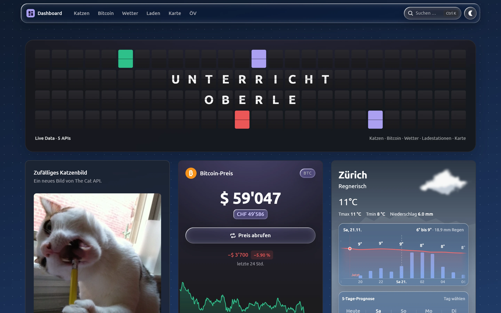

## Contents

- [Highlights](#highlights)
- [Features](#features)
- [Assignment coverage](#assignment-coverage)
- [Tech stack](#tech-stack)
- [Data sources](#data-sources)
- [Getting started](#getting-started)
- [Keyboard shortcuts](#keyboard-shortcuts)
- [Project structure](#project-structure)
- [Known limitations](#known-limitations)
- [Credits](#credits)

## Highlights

- **No framework, no build step.** One HTML file, one stylesheet, one jQuery script. External libraries come from CDNs.
- **Live data from public APIs.** None of them needs an API key.
- **Swiss public transport.** A departures and arrivals board styled as a PowerShell terminal, plus an SBB-style platform display.
- **Google-Maps-style map layers.** Six map types, seven overlays and a 3D view with terrain and buildings.
- **Polished UI.** Liquid glass surfaces, a split-flap hero board, dark and light themes, a command palette and a responsive layout from phone to desktop.

## Features

### Random cat, Bitcoin price and Zurich weather

| Random cat | Bitcoin price | Weather |
|:---:|:---:|:---:|
| 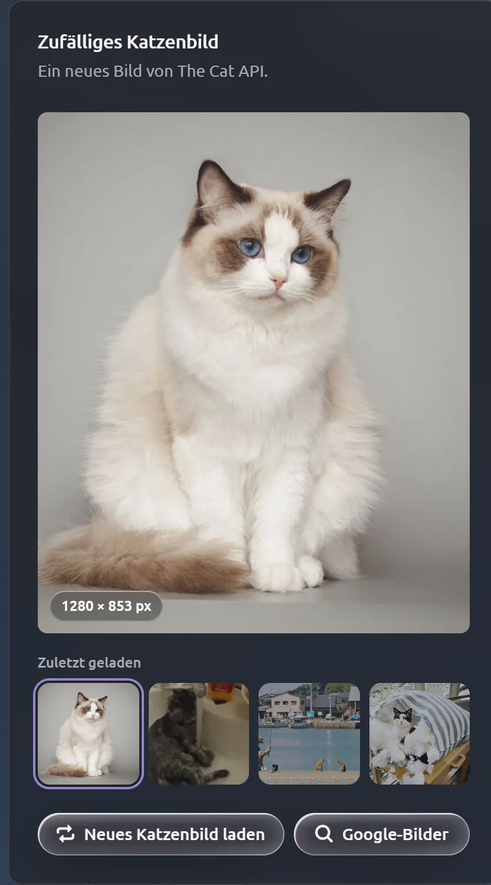 | 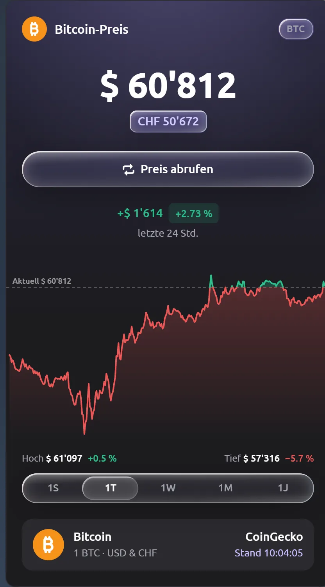 | 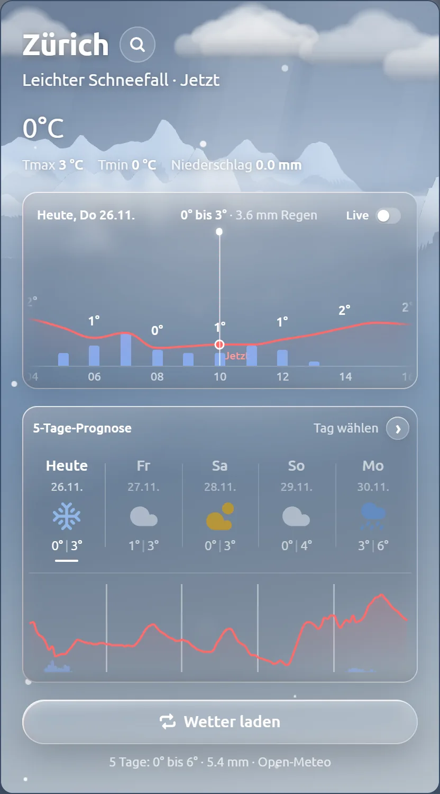 |

- **Random cat:** loads a random image from The Cat API, shows its resolution and keeps a history of the last four images.
- **Bitcoin price:** shows the current price in USD and CHF, the 24-hour change and a price chart with ranges from one hour to one year. The chart is green above the current price and red below it, and marks the high and low.
- **Weather:** current conditions for Zurich from the MeteoSwiss ICON-CH2 model. A swipeable hourly chart shows temperature and rain. A five-day forecast below it selects which day the hourly chart shows.

### EV charging stations and map

| Charging stations | Map layers | 3D view |
|:---:|:---:|:---:|
| 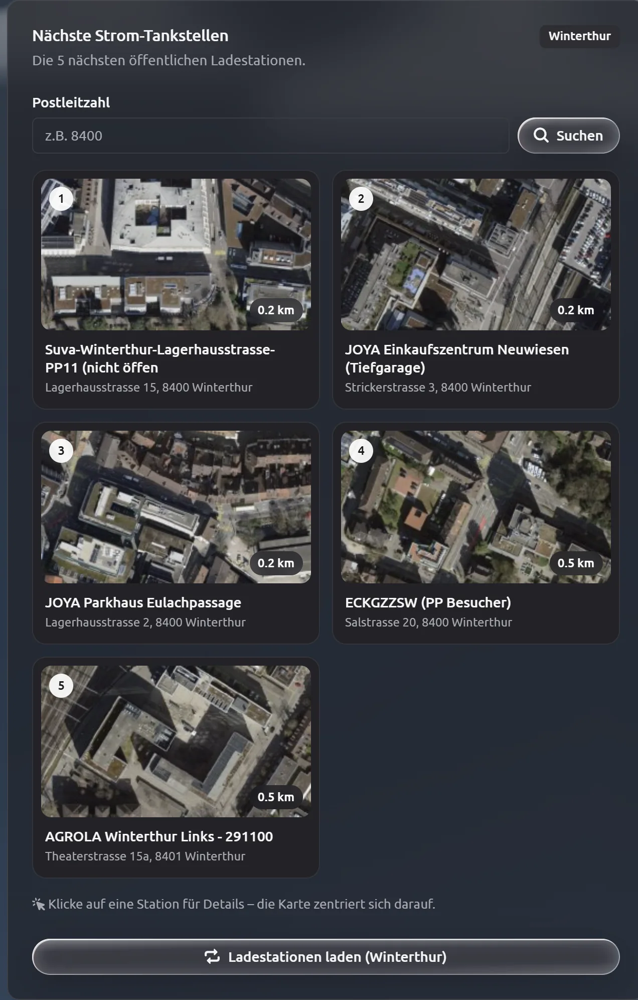 | 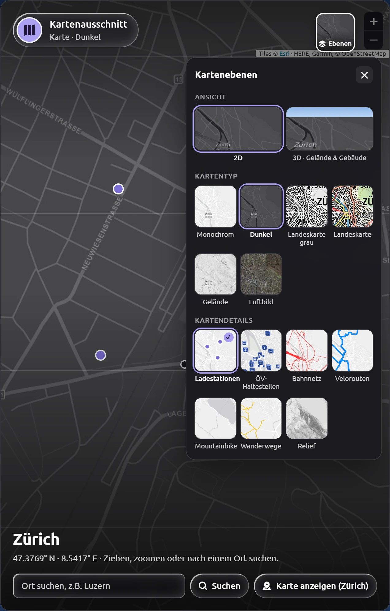 | 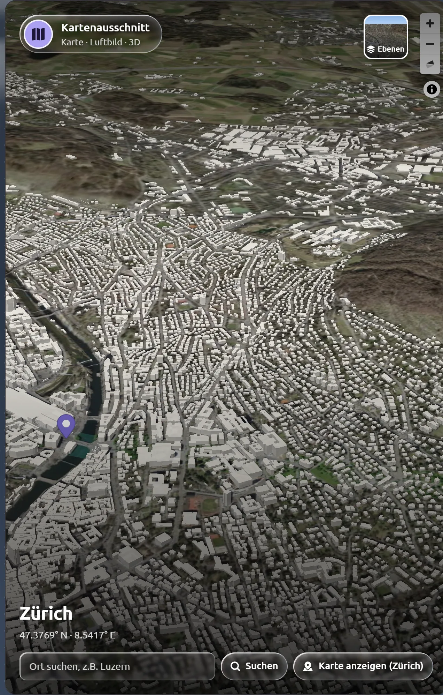 |

- **Charging stations:** the five nearest public charging stations to Winterthur, or to any Swiss postcode. Each card shows an aerial photo of the location and its distance. Clicking a station opens its details and centers the map on it.
- **Map:** Leaflet with a place search powered by the swisstopo geocoder.
- **Layer picker:** works like the one in Google Maps.
  - Map types: Monochrome, Dark, National Map (grey), National Map, Terrain and Aerial.
  - Overlays: charging stations, public transport stops, rail network, cycling routes, mountain bike routes, hiking trails and relief shading.
  - The choice is remembered between visits.
- **3D view:** drapes any map type over real terrain and adds extruded buildings. It runs on MapLibre GL, which is loaded only when 3D is first opened.

### Public transport

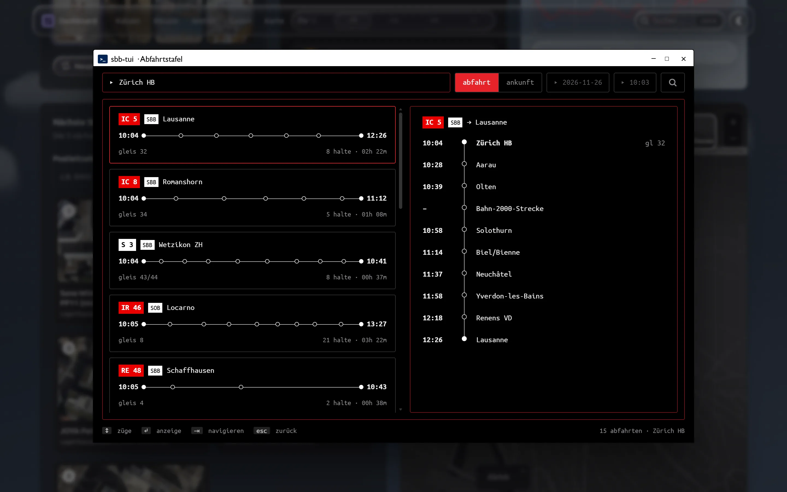

Type a stop name into the terminal on the page and press Enter. The full board then opens:

- **Departures and arrivals:** for any Swiss stop, with platform, delay, travel time and every intermediate stop.
- **Arrivals:** routes back to the origin are loaded in the background. Skeleton placeholders show until each route arrives.

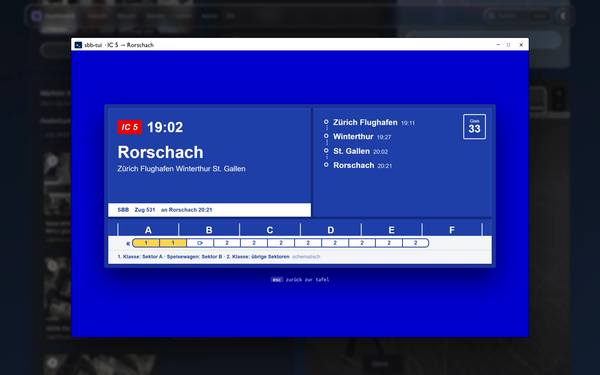

Selecting a train opens a platform display modelled on the SBB screens:

- the line, departure time and destination
- the next stops and the platform
- a sector bar that shows where first class and the dining car stop

### Command palette and mobile layout

| Command palette | Mobile |
|:---:|:---:|
| 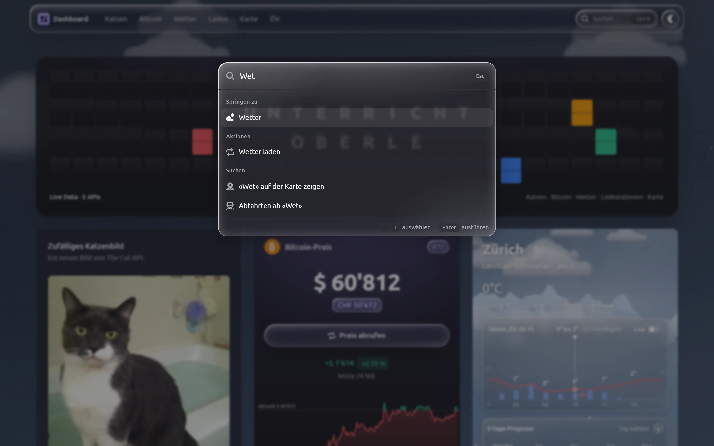 | 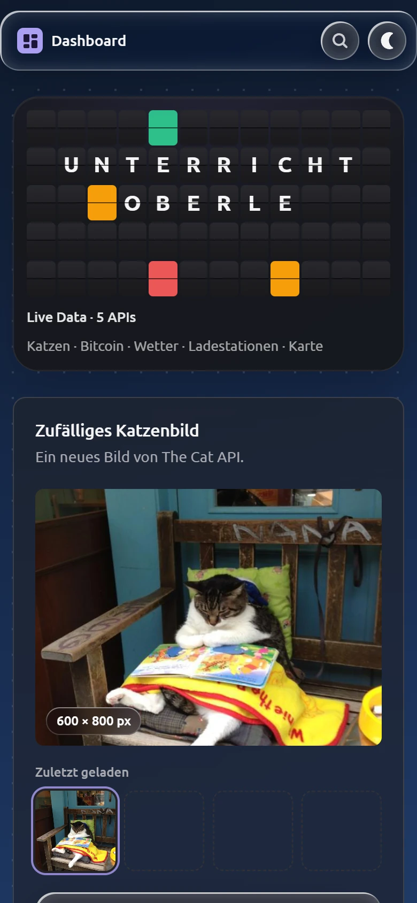 |

The command palette (`Ctrl+K`) jumps to any section, runs actions such as reloading the weather, and searches places on the map or departures from a stop. The layout adapts down to phone width, with full-width cards and a compact header.

## Assignment coverage

| Task | Requirement | Implementation |
|---|---|---|
| a | Random cat image | The Cat API, with image history |
| b | Bitcoin price in USD and CHF | CoinGecko, with 24-hour change and price chart |
| c | Current weather in Zurich and a 5-day chart | Open-Meteo (MeteoSwiss model), Highcharts |
| d | Five nearest EV charging stations from Winterthur, search by postcode | data.geo.admin.ch, api3.geo.admin.ch |
| e | Map section with place search | Leaflet, swisstopo |
| Advanced | Clicking a charging station centers the map | Done, with marker and popup |
| Extras | Beyond the assignment | Public transport board, map layers and 3D view, command palette, scroll animations |

## Tech stack

| Area | Technology |
|---|---|
| Markup and layout | HTML5, [Bootstrap 5.3](https://getbootstrap.com/docs/5.3/) grid |
| Styling | Custom CSS with design tokens for light and dark themes, in the style of [shadcn/ui](https://ui.shadcn.com/) |
| Logic | [jQuery 3.7](https://jquery.com/) (`$.getJSON`, Deferreds) |
| Charts | [Highcharts 11](https://www.highcharts.com/) |
| Maps | [Leaflet 1.9](https://leafletjs.com/), [MapLibre GL JS 4.7](https://maplibre.org/) for the 3D view |
| Animation | [GSAP 3](https://gsap.com/) with ScrollTrigger |
| Icons | [Streamline Core Solid](https://www.streamlinehq.com/icons/core-solid), inlined as an SVG sprite |
| Font | [Ubuntu](https://fonts.google.com/specimen/Ubuntu) and Ubuntu Mono |

The glass effect uses an SVG displacement filter as a `backdrop-filter`. Browsers that cannot do this get a frosted-glass fallback.

## Data sources

All sources are public and need no API key.

| Data | Source |
|---|---|
| Cat images | [The Cat API](https://thecatapi.com/) |
| Bitcoin price and history | [CoinGecko](https://www.coingecko.com/en/api) |
| Weather forecast | [Open-Meteo](https://open-meteo.com/) (MeteoSwiss ICON-CH2) |
| EV charging stations | [Swiss Federal Office of Energy via data.geo.admin.ch](https://data.geo.admin.ch/) |
| Geocoding (places, postcodes) | [swisstopo SearchServer](https://api3.geo.admin.ch/) |
| National maps, aerial photos, overlays | [swisstopo WMTS](https://www.geo.admin.ch/) |
| Grey base maps | [Esri World Light and Dark Gray Canvas](https://www.esri.com/) |
| Terrain heights (3D) | [AWS Terrain Tiles](https://registry.opendata.aws/terrain-tiles/) |
| Buildings (3D) | [OpenFreeMap](https://openfreemap.org/), OpenStreetMap data |
| Public transport | [timetable.search.ch](https://timetable.search.ch/api/help), with [transport.opendata.ch](https://transport.opendata.ch/) as a fallback |

## Getting started

The page is static, but it has to be served over HTTP. Opening `index.html` from the file system blocks some API requests.

1. Clone the repository.
2. Start a local server in the project folder:

   ```bash
   npx http-server -p 5500 -c-1
   ```

3. Open <http://localhost:5500> in a Chromium-based browser (Chrome, Edge) for the full liquid glass effect.

## Keyboard shortcuts

| Shortcut | Action |
|---|---|
| `Ctrl+K` / `Cmd+K` / `/` | Open the command palette |
| Arrow keys, `Enter` | Navigate and run commands in the palette or the departures board |
| `Esc` | Go back one step or close the palette, departures board or map layers |

## Project structure

```
bootstrap-frontend/
├── index.html            Page markup, SVG icon sprite, CDN scripts
├── styles.css            All styles, including light and dark themes
├── app.js                API calls, rendering and interactions (jQuery)
├── wireframe.drawio      Initial wireframe
├── docs/
│   └── screenshots/      Images used in this README
└── README.md
```

## Known limitations

- **Liquid glass:** shows the full refraction effect only in Chromium-based browsers. Other browsers get a simpler frosted look.
- **Train formation:** the free timetable APIs do not include car order, so the sector bar is schematic. It is based on the train type and number, and the display labels it that way.
- **CoinGecko rate limits:** the free CoinGecko API limits requests. Rapid repeated clicks can briefly return no data.
- **3D view:** needs WebGL.

## Credits

- **Terminal windows:** based on components by [mihocsaszilard on uiverse.io](https://uiverse.io/mihocsaszilard) (MIT).
- **Hero board and content card:** inspired by [Aceternity UI](https://ui.aceternity.com/).
- **Liquid glass parameters:** based on the [Liquid Glass CSS Generator](https://hiredigital.com/tools/liquid-glass-css-generator) by Hire Digital.
- **Icons:** [Streamline Core Solid](https://www.streamlinehq.com/icons/core-solid), licensed under CC BY 4.0.
- **Map data:** swisstopo, Esri, OpenStreetMap contributors, OpenFreeMap and Mapzen.
